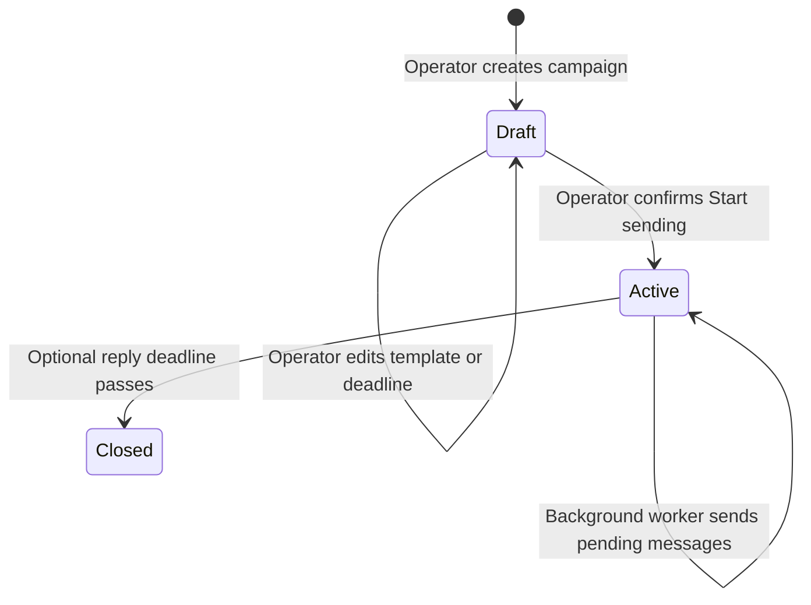

# Campaign lifecycle

## Current flow



```mermaid
sequenceDiagram
    actor Operator
    participant UI as React UI
    participant API as ASP.NET API
    participant DB as SQL Server
    participant Worker as Dispatch worker
    participant SMS as Farapayamak

    Operator->>UI: Create campaign and choose recipients
    UI->>API: POST /api/campaigns
    API->>DB: Save Draft campaign and rendered Pending messages
    API-->>UI: Campaign is ready; no external send
    Operator->>UI: Review or edit campaign
    UI->>API: PATCH /api/campaigns/{id}
    API->>DB: Re-render messages and reset unsent attempts atomically
    Operator->>UI: Confirm Start sending
    UI->>API: POST /api/campaigns/{id}/start
    API->>DB: Atomically change Draft to Active
    Worker->>DB: Claim pending messages from active campaigns
    Worker->>SMS: Form-encoded SendSMS request
    SMS-->>Worker: Provider status and reference
    Worker->>DB: Save Sent or Failed result
```

## Preconditions and guards

- A campaign must have at least one valid recipient.
- Template fields must be known before persistence.
- A deadline, when supplied, must be in the future.
- A campaign with a sent or processing message cannot be edited.
- Starting is an atomic transition allowed only from `Draft`.
- Provider rejection does not mark the message as sent.

## Failure paths

- Transport and provider errors are stored on the outbound message.
- Failed messages can be retried from the delivery-progress page.
- Filtered or invalid provider content remains failed and requires editing before a new start.

## Known gaps

- Provider filtering rules are external and no complete machine-readable blocked-word list is available.
- The application does not yet provide delivery-status polling for outbound provider references.
