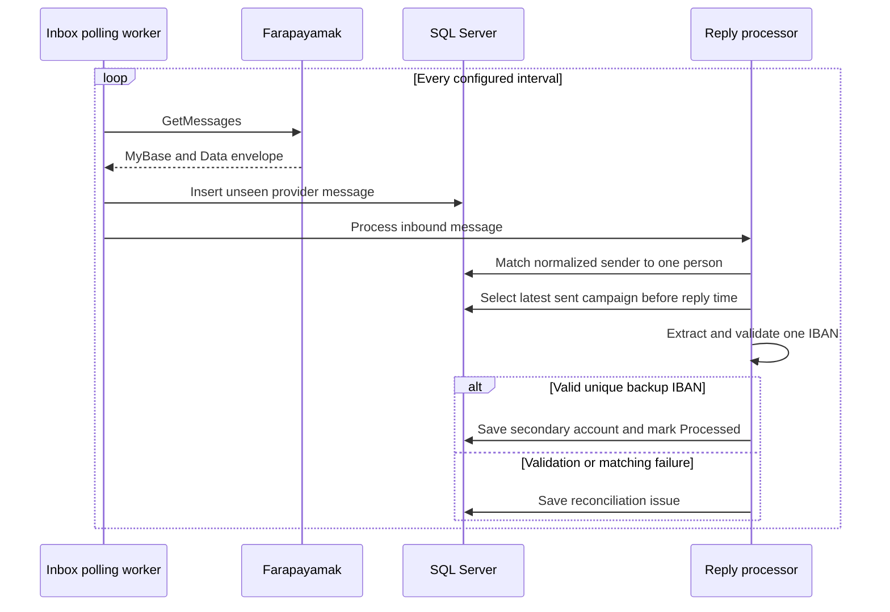

# Inbound reply processing

## Current flow

## Matching and validation

- Sender mobile is normalized before matching.
- Exactly one person must match the sender mobile.
- The campaign is the latest successful outbound message sent before the inbound reply and within the campaign response window.
- The reply must contain exactly one checksum-valid IBAN.
- The backup IBAN must differ from the person's current IBAN and must not belong to another person in the collected data.
- Ownership verification is intentionally not performed.

## Side effects and failure paths

- Successful processing creates one secondary account per person and campaign.
- Optional confirmation SMS is sent only after a successful record and when enabled on the campaign.
- Ambiguous, missing, invalid, duplicate, or inactive-request replies create a reconciliation issue.
- The UI polls its database view every 15 seconds and supports explicit refresh, filtering, and pagination.

## Known gaps

- Provider timestamps are accepted as supplied; clock or timezone inconsistencies can affect temporal matching.
- Polling is used because no stable public webhook endpoint is available.
