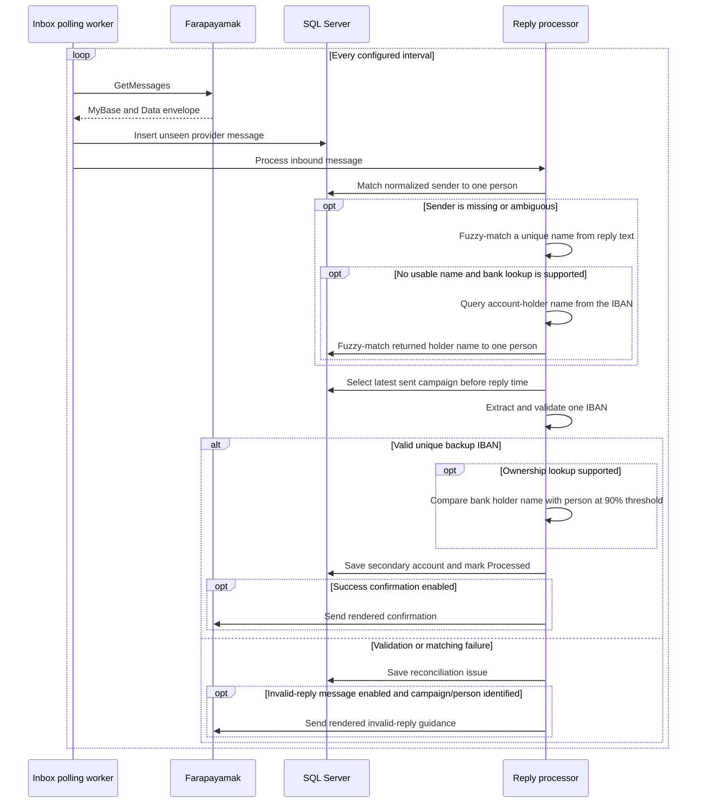

# Inbound reply processing

## Current flow

## Matching and validation

- Sender mobile is normalized before matching.
- A unique sender-mobile match is preferred. When the mobile is missing or maps to multiple people, the processor can link a unique person from a name embedded in the reply. It requires at least 90% normalized similarity and a five-percentage-point lead over the second candidate.
- If no usable name appears in the reply and the IBAN bank supports ownership lookup, the returned account-holder name is matched by the same rule. The inferred person is stored on the inbound message without changing the person's mobile.
- Name normalization covers whitespace and line breaks, Persian/Arabic letter variants, and minor token-order differences. Confirmation SMS is suppressed for name-inferred matches.
- The campaign is the latest successful outbound message sent before the inbound reply and within the campaign response window.
- The reply must contain exactly one checksum-valid IBAN.
- Canonical `IR` IBANs, 24 contiguous digits, supported grouped formats, and Persian or Arabic digits are normalized before validation.
- A 25-digit candidate is accepted only when deleting one digit produces exactly one checksum-valid IBAN.
- A 23-digit candidate is accepted only when inserting one digit in all possible positions produces exactly one checksum-valid IBAN. Ambiguous candidates remain under review.
- Supported grouped bodies include `4-4-4-4-8` hyphen groups and four 6-digit groups separated by slash, hyphen, or dash.
- The backup IBAN must differ from the person's current IBAN and must not belong to another person in the collected data.
- Ownership verification is tri-state: `true` for a confirmed name match, `false` for a confirmed mismatch, and `null` when unsupported, unattempted, unavailable, or inconclusive.
- Bank Saderat (`019`) currently supports automated ownership lookup through an isolated hidden-browser session. Other bank codes remain `null` until an adapter is implemented.
- A confirmed ownership mismatch does not finalize a new reply. Existing accounts are retained, marked `false`, and moved to `AccountHolderNameMismatch` review. An unavailable bank or inconclusive response never changes message status.

## Card-to-IBAN review

- Card replies remain reconciliation items until an operator starts the bank conversion and confirms the result.
- Bank Mellat cards with prefixes `610433` and `991975` are handled through the bank's official electronic counter in an isolated hidden-browser session.
- The operator enters the bank CAPTCHA shown in the panel. The system submits the four card segments in the same bank session, follows the confirmation step, and accepts only one checksum-valid IBAN.
- When the bank returns an account-holder name, it is compared with the linked person at the same 90% normalized-name threshold. A mismatch stays open as `AccountHolderNameMismatch`.
- Person resolution consistently prefers `InboundMessage.MatchedPersonId`. A unique sender-mobile match is only the fallback. This rule applies to issue display, bank-holder comparison, and manual finalization.
- Manual finalization resolves only open issues for the same campaign and linked person. For messages without a linked person, the legacy unique-mobile scope is retained.

## Side effects and failure paths

- Successful processing creates one secondary account per person and campaign.
- Optional confirmation SMS is sent only after a successful record and when enabled on the campaign.
- Optional invalid-reply SMS is sent after the reconciliation issue is committed, only when both the person and campaign are known.
- Ambiguous, missing, invalid, duplicate, or inactive-request replies create a reconciliation issue.
- The UI polls its database view every 15 seconds and supports explicit refresh, filtering, and pagination.
- Inbound search and inbound/secondary-account exports can be restricted to a campaign. Campaign association comes from either the successful secondary account or the reconciliation issue.
- Inbound Excel export includes terminal number and national code. Manual resolutions remain successful and are distinguished from automatic resolutions in a separate finalization-method column. Secondary-account Excel and CSV exports expose the same method distinction.
- For `MultipleDifferentReplies`, the inbox displays up to ten earlier replies from the same sender and campaign, newest first.

## Known gaps

- Provider timestamps are accepted as supplied; clock or timezone inconsistencies can affect temporal matching.
- Polling is used because no stable public webhook endpoint is available.
- Automated confirmation and invalid-reply provider calls are made after the database transaction; a provider failure does not roll back the successfully classified inbound message.
- Public bank pages and anti-automation controls are external dependencies. Unsupported banks and transient lookup failures deliberately leave ownership as unknown rather than creating a mismatch.
- Bank Mellat conversion requires a fresh CAPTCHA and an unchanged official form. Expired sessions, bank-side validation errors, and form changes fail without recording an IBAN.
