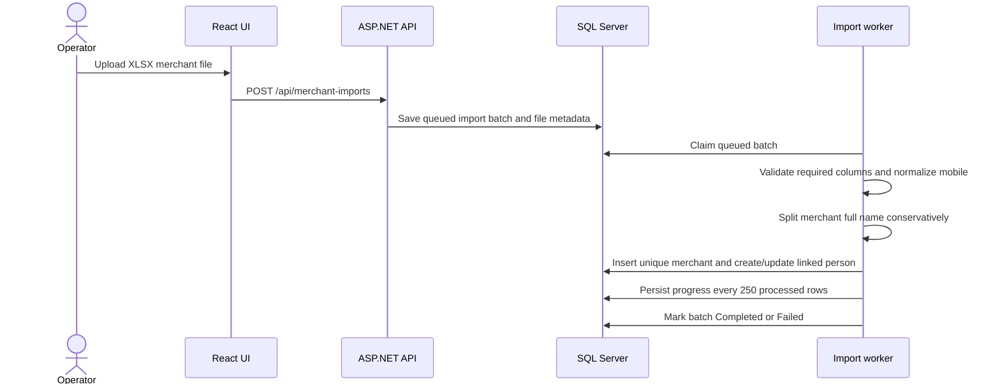

# Merchant import and person-name normalization

## Current flow

## Name handling

- The source column `نام پذیرنده` remains the merchant display name.
- Linked people store separate `FirstName` and `LastName` values.
- Known compound Persian first names are preserved; remaining tokens form the possibly multi-part family name.
- Honorifics such as the Persian equivalents of Mr. and Ms. are removed before splitting.
- A single-token value is not guessed and remains only in `FirstName`.
- Manual merchant creation uses the same parser.
- The startup normalization worker only changes legacy people whose family name is empty and whose first-name field contains multiple tokens. Once split, a row is not selected again.

## Failure and rollback behavior

- Invalid required fields and duplicate terminal numbers are counted and skipped.
- Progress is committed in batches, so a later failure does not roll back already committed rows; the batch records the failure for operator review.
- Invalidating an import removes its merchant rows and removes only people created by that batch that are not referenced by outbound messages or secondary accounts.

